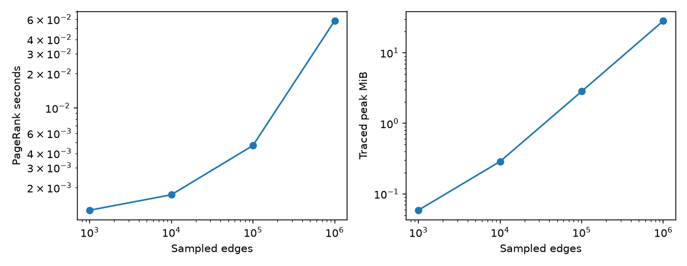

# Measured benchmark results

These are single runs in the provided Linux cloud environment with Python 3.12.14,
NumPy 2.5.4, SciPy 1.18.1, NetworkX 3.7, and scikit-learn 1.9.1. Numerical runs set
`OPENBLAS_NUM_THREADS=1`. Exact machine/library metadata is stored beside each CSV.
They are observations, not service latency guarantees or statistical comparisons.

| Measurement | Result | Scope |
|---|---:|---|
| PageRank, 1,000,000 sampled edges | 0.0581 s | 999,957 unique edges, 100,000 nodes, 19 iterations |
| Sparse construction + transition | 0.0633 s | Same graph; separate from iteration time |
| Traced peak allocation | 28.33 MiB | Construction + iteration; excludes initial edge arrays; not total RSS |
| Dijkstra, 10,000 nodes | 0.0881 s | 100×100 unit-cost grid |
| Weighted Brandes, 100 nodes | 0.0155 s | Seed-42 preferential-attachment graph |
| NetworkX weighted Brandes, same graph | 0.0338 s | Same topology and weights; one run |
| All-node failure ranking, 100 nodes | 1.3152 s | Same synthetic graph |
| Synthetic search precision@10 | PPR 0.50; TF-IDF 0.10 | 20 authored queries over four isolated topic cycles |
| Synthetic anomaly precision / recall | 0.7692 / 1.0000 | 10 true positives, 3 false positives; separate train/calibration/test |

The search example deliberately gives five documents per topic, making maximum
precision@10 equal to 0.5. Relevance comes from synthetic topic membership; the
query appears in one document and citations connect the other four. This checks
graph expansion but does not predict quality on SEC filings. Supply at least 20
human-labeled real queries to the same runner for a production evaluation.

The anomaly benchmark uses numeric low-rank synthetic data. It does not measure
the default within-corpus document threshold's accuracy, which needs independent
tenant labels and calibration. See [SVD notes](../notebooks/03_svd_anomaly.md).

## Reproduce

From the checkout, after installing `.[dev]`:

```bash
export OPENBLAS_NUM_THREADS=1
export MPLCONFIGDIR=/tmp/meridian-mpl
export XDG_CACHE_HOME=/tmp/meridian-cache
python -m benchmarks.bench_pagerank_scale
python -m benchmarks.bench_network
python -m benchmarks.bench_anomaly
python -m benchmarks.bench_search_quality examples/search_evaluation.json
python scripts/generate_math_artifacts.py
```

Each run replaces its CSV and metadata. The PageRank runner also writes a plot.
Source and outputs live in [benchmarks](../benchmarks/).



## Illustrative infrastructure

| Removed component | Newly unreachable pairs | Remaining weak components |
|---|---:|---:|
| api | 55 | 6 |
| worker | 38 | 4 |
| cloudflare | 21 | 2 |

The API is the attachment point for several leaves and the edge-to-worker path.
The worker connects storage and model-provider leaves. Cloudflare disconnects
the client from the rest. PostgreSQL has two links in this model, so its removal
does not partition surviving nodes; this structural model does not capture the
semantic fact that the application requires a working database. These are model
results, not a verified map or availability assessment of the deployed system.
