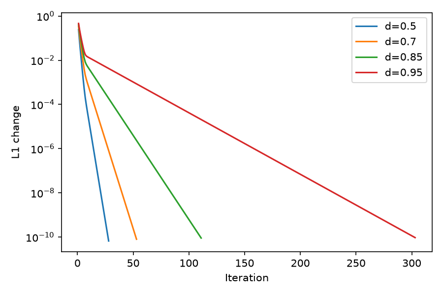

# Convergence under damping

The fixed synthetic graph has 100 nodes, 400 sampled weighted edges, and seed 42.
The chart measures `||r_next-r||_1` at d=0.5, 0.7, 0.85, and 0.95 using the same
starting vector. Larger damping requires more iterations on this graph because
less probability is reset by teleportation. This is a measured example, not a
claim that every graph has a strictly monotone iteration count.

Counts and reproduction code: [measurements](assets/measurements.json),
[`generate_math_artifacts.py`](../scripts/generate_math_artifacts.py).
